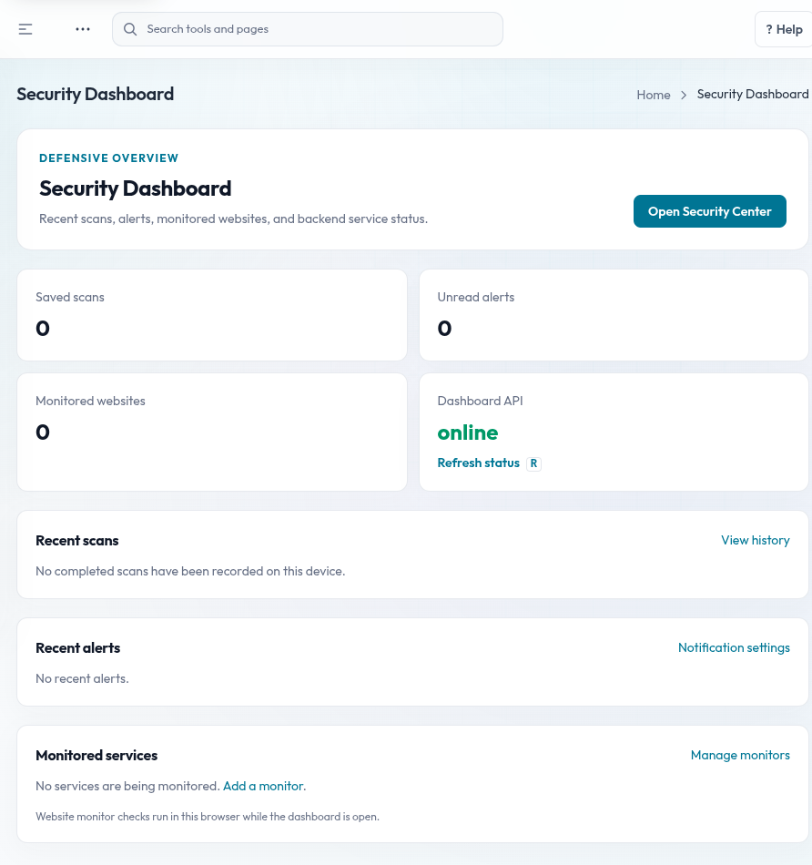
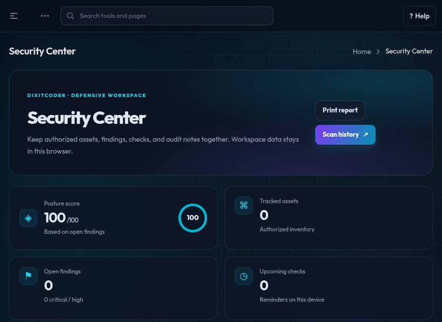
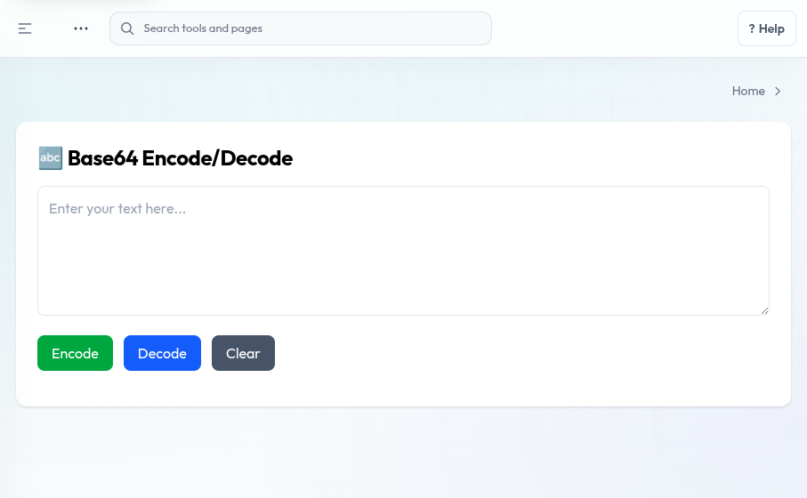

# DixitCoder Security Dashboard

A full-stack Vue 3, TypeScript, and Node.js dashboard that brings workspace management, system diagnostics, developer utilities, and security-related tools into one interface.

> **Use responsibly:** security and network checks can contact the host or service entered in a tool. Run checks only against systems you own or have explicit permission to assess. Do not expose an unreviewed development server to the internet.

## Project at a glance

- **62 Vue Router route definitions** for dashboards, utilities, account pages, and UI examples.
- **59 Vue view files** and **56 reusable Vue components** in the current frontend source tree.
- A Vue/Vite frontend with an Express API server.
- Server-validated sign-in, administrator-managed accounts, and an API health check.
- A modular layout with separate frontend views, shared components, and backend route modules.

Counts describe source files and routes, not the number of services independently tested or guaranteed to work in every environment.

## UI screenshots

These are representative screens captured from the running local app: sign-in, a security overview, the local Security Center, and a developer utility. They are examples, not screenshots of every route. The dashboard screens show an empty local workspace; personal user-directory and profile pages are intentionally not included.

### Sign in


### Security overview



### Security Center



### Developer utility



## What can I do with it?

### Dashboard and workspace

- Review the main dashboard, API availability, recent navigation, saved scan activity, and quick-launch links.
- Use the Security Dashboard and Security Center to organize authorized assets, track findings, and maintain local reminders.
- Manage workspace preferences, themes, profile details, calendar items, and administrator-managed user accounts.

### Network and system diagnostics

- Inspect local system and network information, CPU activity, network statistics, processes, and ARP entries.
- Use the IP information, ping, port/service, network-map, router, traceroute, GeoIP, bandwidth, and packet-capture interfaces.
- Check file integrity and view port-forwarding information.

### Website and security checks

- Review WHOIS and DNS records, SSL/TLS information, HTTP security headers, DNS privacy, firewall behavior, and website monitor status.
- Open the web-scan and vulnerability-scan interfaces and review their results or scan history.

### Developer utilities and dashboard UI

- Encode/decode Base64; generate hashes; format JSON; test regular expressions; and inspect API health.
- Browse image-analysis interfaces, charts, tables, reusable form controls, alerts, badges, and other UI examples.

Some screens depend on a working backend, local operating-system capabilities, network access, and tool-specific permissions. Android APK generation and remote-handler endpoints are intentionally disabled. A screen being present does not guarantee its service is enabled.

## First-time setup

### Requirements

- Node.js 18 or later
- npm

### Install dependencies

From the project root:

```bash
npm install
npm --prefix server install
```

### Configure the local administrator

1. Copy `.env.example` to `.env` in the project root.
2. Set `AUTH_USERNAME` to the initial administrator username.
3. Set `AUTH_PASSWORD_HASH` to a **scrypt password hash** in this format: `scrypt$<salt>$<128-character-hex-hash>`. The server does not accept a plaintext password in this setting.
4. Set `AUTH_SESSION_SECRET` to a newly generated random value of at least 32 characters.
5. Keep `.env` private. Do not commit it, share it, or reuse the sample placeholder values.

The initial administrator account is created from these settings when the local user store is first initialized. Self-service sign-up is disabled; administrators create and manage accounts in User Management.

### Start the dashboard and API

From the project root:

```bash
npm run dev
```

This starts the Vite frontend (typically `http://127.0.0.1:5173`) and the Express API (default `http://127.0.0.1:3001`). Keep the terminal running. Open the Vite address, sign in with the administrator account configured above, and use the sidebar or search to open a dashboard or tool.

The API health endpoint is `http://127.0.0.1:3001/api/health`. A healthy response confirms only that the API process responds; it does not prove that every route or integration works.

## How to use the tools

1. Sign in to your local workspace.
2. Open the relevant tool from the sidebar or dashboard search.
3. Before any network or website check, confirm the target is within your written authorization and scope.
4. Enter only the required information, run the check, and review the result and any errors.
5. Use Scan History or Security Center to review locally saved activity where supported.

Some utilities inspect the computer or network running the backend, rather than the browser device. Packet capture and other system-level checks may require operating-system permissions and may not work on every platform.

## Run frontend checks

Create a production frontend build and run the TypeScript checks:

```bash
npm run build
```

Preview the generated frontend build locally:

```bash
npm run preview
```

These commands validate/build the frontend; they are not an end-to-end test of all backend routes, external services, or network tools.

## Privacy and data

- `.env` contains local authentication secrets and must stay private.
- The backend creates its local account store at `server/data/users.json`; do not publish account data or password hashes.
- User-uploaded files in `server/uploads/` may contain personal information.
- Dashboard preferences and some activity records are stored in the browser on the local device.

## Technology

- Vue 3, TypeScript, Vue Router, and Vuex
- Vite and Tailwind CSS
- Node.js and Express
- Axios, ApexCharts, and dashboard component libraries

## Third-party notices

This project is customized from an existing Vue dashboard template and includes third-party components and assets. Retain applicable notices and comply with the licenses of included work.
