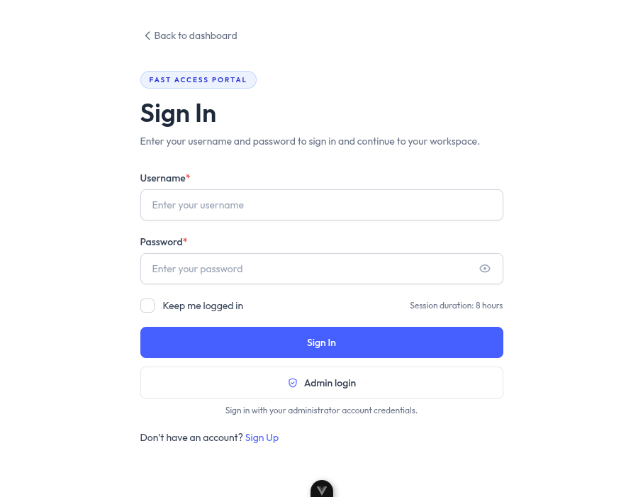

# DixitCoder Security Dashboard

A Vue 3 and TypeScript dashboard project with a substantial frontend: dashboard pages, reusable components, charts, account screens, and interfaces for network and security utilities.

> **This public repository is a frontend preview, not a complete working deployment.** The server/API source is intentionally not published here. Sign-in, account management, and API-powered tools need a separately operated backend; they will not work from this repository alone.

## Preview



The image shows the sign-in screen. It is not a screenshot of working API tools.

## What's included

- Vue 3, TypeScript, Vue Router, and Vite application source.
- Dashboard layouts, chart components, icons, and bundled visual assets.
- Frontend screens for account management, diagnostics, and security-related utilities.
- A responsive interface intended to connect to a separately configured API.

The project is more than a static mock-up, but the public frontend source does not include the backend services needed to authenticate or run API-backed features. Do not treat visible tool screens as proof that their services are available.

## Run the frontend preview

Requirements: Node.js 18 or later and npm.

```bash
npm install
npm run frontend
```

Open the local address printed by Vite (typically `http://127.0.0.1:5173`). You can inspect the sign-in screen and frontend UI; login and API-backed tools require a separately provisioned backend.

To type-check and create a production frontend build:

```bash
npm run build
```

## Backend and service status

The backend is not part of this public repository, so cloning this project alone cannot start the API or make all services usable. On a separately operated local backend, the health check is available at `http://127.0.0.1:3001/api/health`. A healthy response only confirms that the API process is reachable; it does **not** mean every feature or integration works.

Only connect to a backend you own or are authorized to use. Security and network utilities must only be used on systems for which you have explicit permission. Do not expose an unreviewed development server to the internet.

## Privacy and licensing

- Never publish `.env`, credentials, session secrets, password hashes, user records, or uploaded files.
- The dashboard is customized from an existing Vue dashboard template. Retain applicable third-party notices and comply with the licenses for included components and assets.
